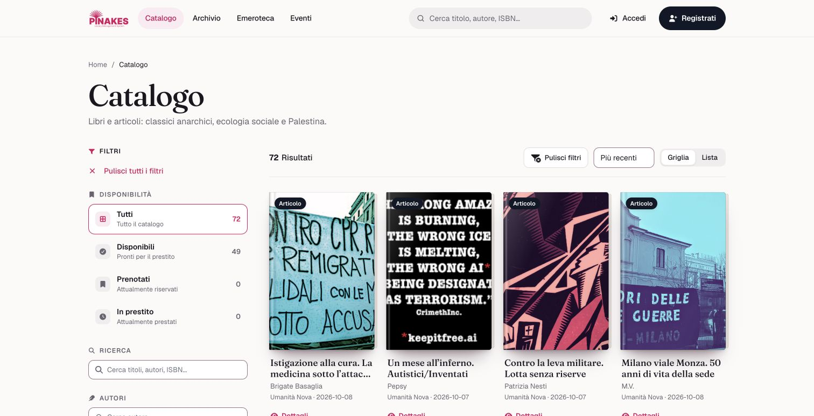
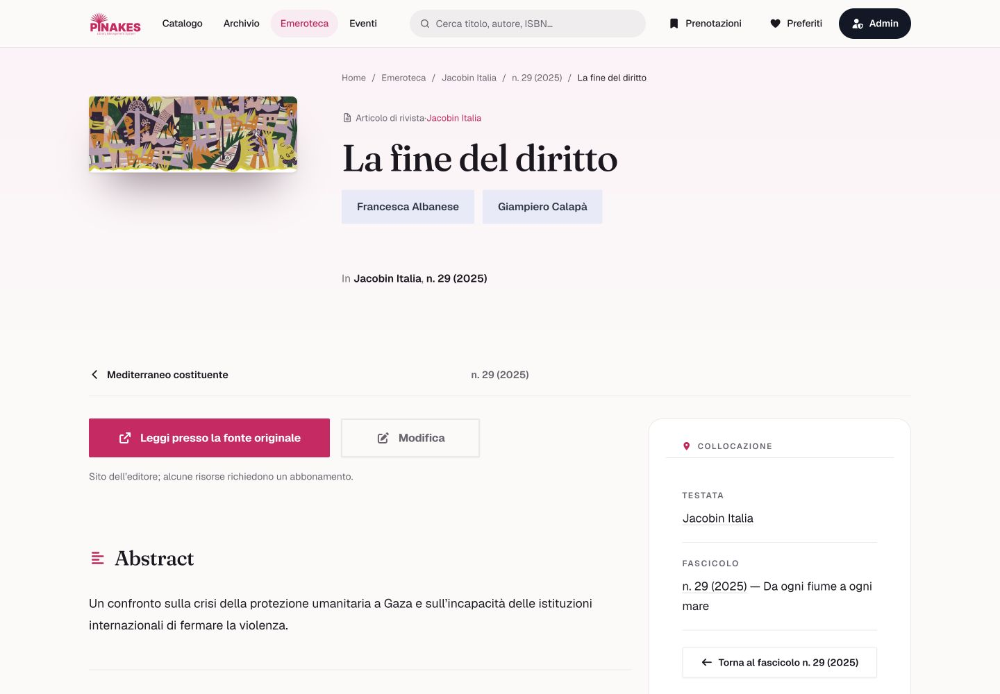
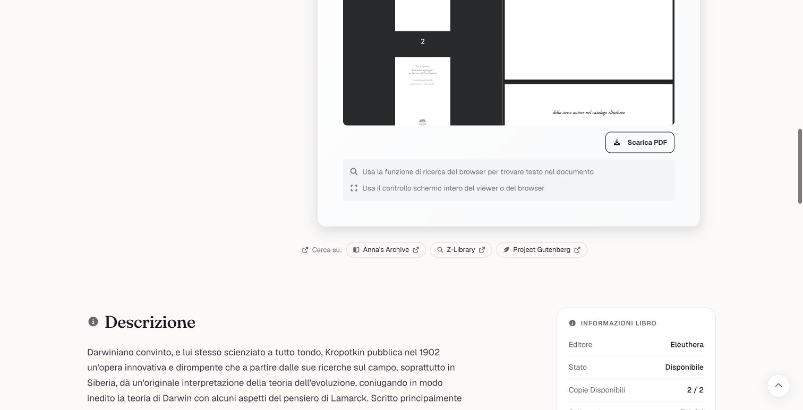
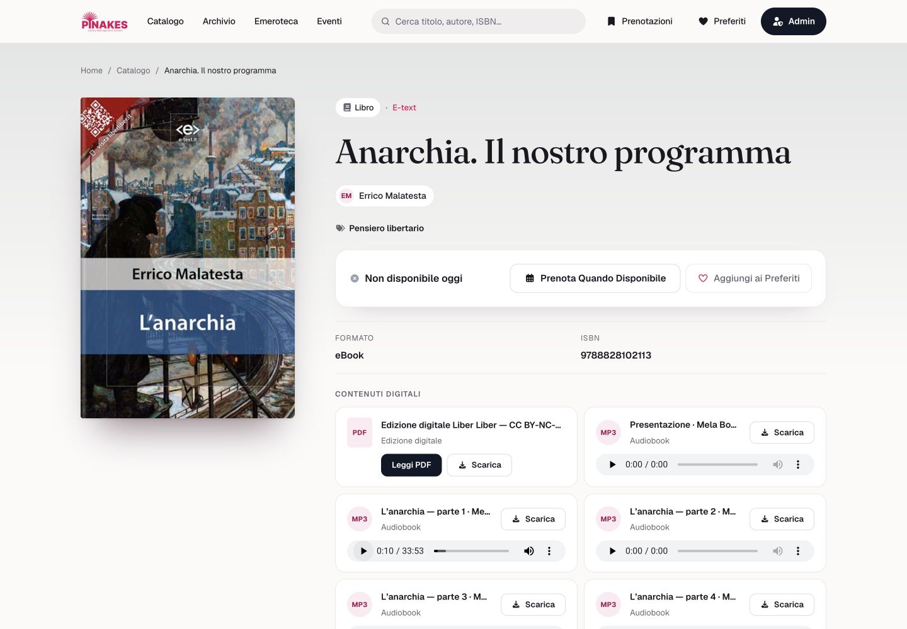
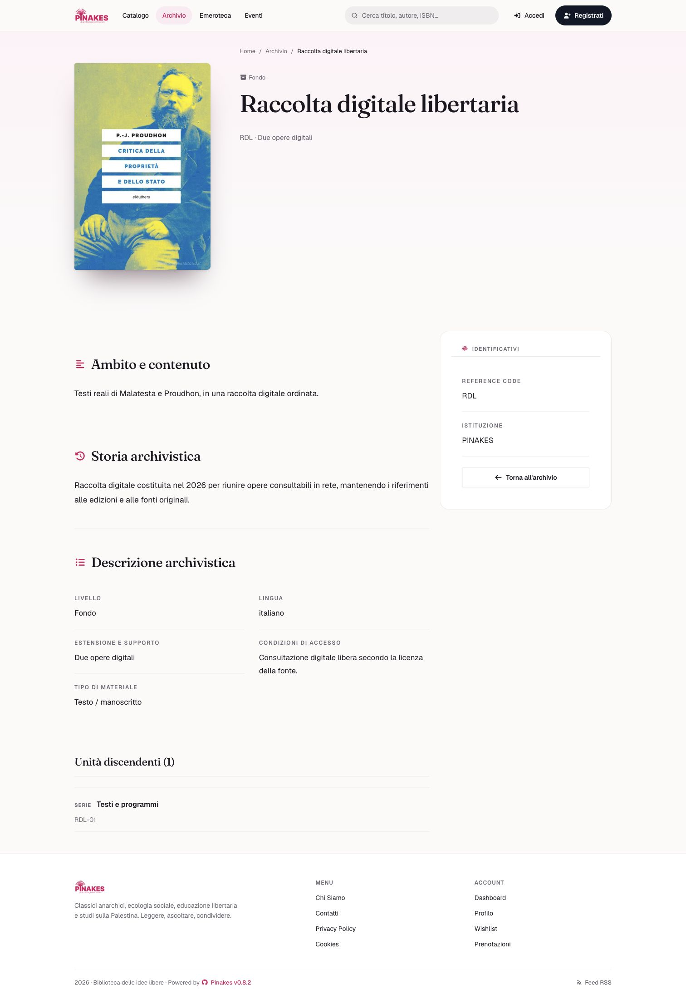

# Biblioteca delle idee libere

[Open the public showcase](https://biblioteca.fabiodalez.it/). Captured and checked on 12 October 2026, Pinakes 0.8.2.

The catalogue contains real editions, real periodicals and real articles. Inventory, copies, archive arrangement and activities demonstrate the software; this installation is not an operating lending library.

| Collection | Records |
| --- | ---: |
| Catalogue books | 50 |
| Desiderata | 8 |
| Periodicals / issues | 3 / 10 |
| Illustrated articles | 22 |
| Complete PDF texts | 11 |
| Audiobooks / tracks | 2 / 12 |
| Reading clubs | 2 |
| Archive units | 4 |

## Explore

- [Catalogue](https://biblioteca.fabiodalez.it/catalogo)
- [Wanted books](https://biblioteca.fabiodalez.it/#desiderata-heading)
- [Periodicals](https://biblioteca.fabiodalez.it/emeroteca)
- [Article: La fine del diritto](https://biblioteca.fabiodalez.it/emeroteca/articolo/4)
- [Malatesta: digital editions and audio](https://biblioteca.fabiodalez.it/errico-malatesta/anarchia-il-nostro-programma/144)
- [Reading clubs](https://biblioteca.fabiodalez.it/book-club)
- [Digital archive](https://biblioteca.fabiodalez.it/archivio)

## Sources and editions

The installed Scraping Pro plugin supplied bibliographic enrichment. Publisher records resolved conflicting creator roles, dates and pagination; author names were consolidated. Shelf marks use actual shelf/mensola records, for example `E-1-04`, and inventory codes use `2026-00001`.

[Book sources](catalogue-sources.json) and [periodical/article sources](periodical-sources.json) list the original publications. Covers and article images retain their respective owners’ rights; the code licence does not grant rights to those images.

Ten PDFs are copyleft editions published by elèuthera. Malatesta’s PDF and Italian recording by Mela Boev come from [Liber Liber](https://liberliber.it/autori/autori-m/errico-malatesta/lanarchia-audiolibro/) under CC BY-NC-SA 4.0. The ISBN record identifies the E-text ebook; the attached Liber Liber version is a distinct edition. Bakunin’s [God and the State](https://librivox.org/god-and-the-state-by-mikhail-bakunin/) is the complete English LibriVox recording by Carl Manchester, not an Italian audiobook.

## Screenshots

Desktop and 390 × 844 mobile browser views. Some detailed screenshots were captured with a staff session; management buttons in those images are not offered to anonymous visitors.

| Catalogue | Book |
| --- | --- |
|  |  |
|  |  |
|  |  |
|  |  |

## Verification

[Checks and issues discovered during preparation](verification.md). A full database/upload backup was validated before replacing the old collection and is retained privately outside the public web directory.
